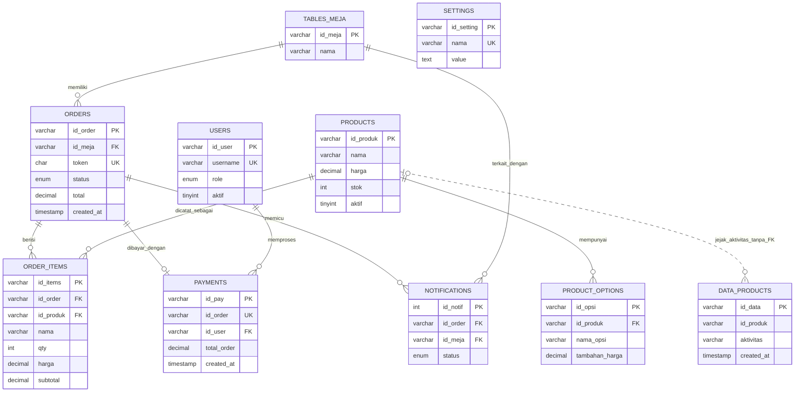

# ERD, LRS, dan Kamus Data

Dokumen ini menggambarkan target skema setelah migrasi keamanan dan PR-09. File SQL migrasi bersifat manual; dokumentasi ini tidak menandakan bahwa migrasi telah dijalankan pada suatu database.

## ERD

`DATA_PRODUCTS.id_produk` sengaja tidak memiliki foreign key agar jejak aktivitas tetap tersedia ketika produk dinonaktifkan atau dihapus. Penghapusan produk yang dirujuk `ORDER_ITEMS`, meja yang dirujuk `ORDERS`, dan pengguna yang dirujuk `PAYMENTS` dibatasi oleh foreign key `RESTRICT`.

## LRS

- `TABLES_MEJA(id_meja PK, nama)`
- `ORDERS(id_order PK, id_meja FK → TABLES_MEJA.id_meja, token UNIQUE, status, total, nama_pelanggan, metode_pembayaran, created_at, updated_at)`
- `ORDER_ITEMS(id_items PK, id_order FK → ORDERS.id_order, id_produk FK → PRODUCTS.id_produk, nama, kategori, opsi, catatan, suhu, harga, qty, subtotal, created_at)`
- `PAYMENTS(id_pay PK, id_order UNIQUE FK → ORDERS.id_order, id_user FK → USERS.id_user, nama_kasir, metode_pembayaran, total_order, uang_dibayar, kembalian, created_at)`
- `USERS(id_user PK, username UNIQUE, password, nama_kasir, role, aktif, created_at)`
- `PRODUCTS(id_produk PK, nama, kategori, harga, stok, varian_suhu, tambahan_harga_es, gambar, suhu_tetap, punya_opsi, label_opsi, deskripsi, aktif, created_at)`
- `PRODUCT_OPTIONS(id_opsi PK, id_produk FK → PRODUCTS.id_produk, nama_opsi, tambahan_harga, gambar, urutan, aktif, created_at)`
- `NOTIFICATIONS(id_notif PK, id_order FK → ORDERS.id_order, id_meja FK → TABLES_MEJA.id_meja, nama_pelanggan, total, status, created_at)`
- `SETTINGS(id_setting PK, nama UNIQUE, value)`
- `DATA_PRODUCTS(id_data PK, id_produk tanpa FK, aktivitas, nama_produk, nama_kasir, created_at)`

## Kamus data ringkas

| Tabel | Kolom dan fungsi |
| --- | --- |
| `tables_meja` | `id_meja` identitas meja (PK); `nama` label meja. |
| `orders` | `id_order` identitas pesanan (PK); `id_meja` meja (FK); `token` akses publik acak (UNIQUE); `nama_pelanggan`, `total`, `metode_pembayaran`, `created_at`, `updated_at`; `status` hanya `menunggu_pembayaran` atau `lunas`, default `menunggu_pembayaran`. Indeks status/waktu: `(status, created_at)`. |
| `order_items` | `id_items` identitas detail (PK); `id_order` (FK); `id_produk` produk referensi (FK, hapus dibatasi); `nama`, `kategori`, `opsi`, `catatan`, `suhu` snapshot pesanan; `harga`, `qty`, `subtotal`, `created_at`. |
| `payments` | `id_pay` identitas pembayaran (PK); `id_order` pesanan (FK, UNIQUE: satu pembayaran per pesanan); `id_user` kasir (FK, hapus dibatasi); `nama_kasir` snapshot nama; `metode_pembayaran`, `total_order`, `uang_dibayar`, `kembalian`, `created_at`. |
| `users` | `id_user` identitas pengguna (PK); `username` login (UNIQUE); `password` hash; `nama_kasir`; `role`; `aktif` status akun; `created_at`. |
| `products` | `id_produk` identitas menu (PK); `nama`, `kategori`, `harga`, `stok`, `gambar`, `deskripsi`; atribut suhu `varian_suhu`, `tambahan_harga_es`, `suhu_tetap`; atribut opsi `punya_opsi`, `label_opsi`; `aktif`; `created_at`. |
| `product_options` | `id_opsi` identitas pilihan (PK); `id_produk` menu induk (FK); `nama_opsi`, `tambahan_harga`, `gambar`, `urutan`, `aktif`, `created_at`. |
| `notifications` | `id_notif` identitas notifikasi (PK); `id_order` pesanan terkait (FK); `nama_pelanggan` dan `total` snapshot notifikasi; `status`; `created_at`. |
| `settings` | `id_setting` identitas pengaturan (PK); `nama` kunci pengaturan (UNIQUE); `value` nilai pengaturan. |
| `data_products` | `id_data` identitas catatan aktivitas (PK); `id_produk` identitas produk tanpa FK; `aktivitas`, `nama_produk`, `nama_kasir`, `created_at`. Baris ini dipertahankan sebagai jejak historis. |

Unique index pada `users.username`, `payments.id_order`, dan `settings.nama` dibuat oleh `database/migrasi_keamanan.sql`. Sebelum menjalankan migrasi pada salinan database, jalankan pemeriksaan duplikat di bagian 0 dan selesaikan setiap hasilnya.
